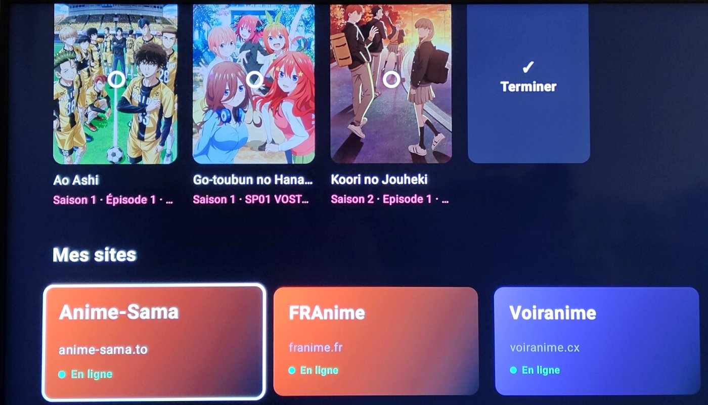
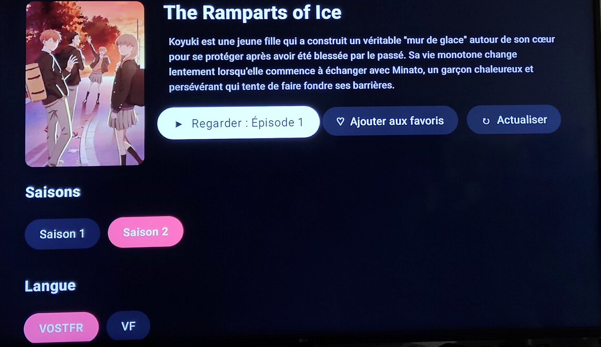

# AnimeTV

**Une application pour Google TV / Android TV qui transforme des sites d'animes en vrai catalogue à la télécommande.**
Pas de curseur, pas de pubs, pas de menus de site : l'application lit les sites à ta place et t'affiche les affiches, les saisons, les épisodes et les lecteurs, prêts à lancer.

### 📥 [Télécharger AnimeTV.apk](https://github.com/tad15/AnimeTV/releases/latest/download/AnimeTV.apk)

Les versions suivantes s'installent ensuite **directement depuis l'application** (bouton « Mises à jour »). Le détail de chaque version est dans les [notes de version](https://github.com/tad15/AnimeTV/releases).

---

## Aperçu

| Accueil | Fiche d'un anime |
|---|---|
|  |  |

*Photos prises sur une vraie télé.*

---

## Sites pris en charge

| Site | Fonctionnement |
|---|---|
| **Anime-Sama** | ✅ Mode dédié : fonctionne parfaitement |
| **FRAnime** | ✅ Mode dédié : fonctionne parfaitement |
| **Voiranime** | ✅ Mode dédié : fonctionne parfaitement |
| **SenAnimes** | 🧪 Ajouté en mode universel, mode dédié en préparation |
| **Tout autre site** | ⚠️ Mode universel : l'application devine elle-même où sont les affiches, saisons, épisodes et lecteurs. Ça marche sur beaucoup de sites, mais **moins bien et moins proprement** que les sites en mode dédié. |

Les sites principaux sont déjà ajoutés au premier lancement. Sous chaque site, un petit point indique son état (**En ligne**, **Lent**, **Répond mal**, **Hors ligne**), vérifié à chaque démarrage.

**Le site a changé d'adresse ?** (par exemple `voir-anime.to` devenu `voiranime.cx`) : *Gérer → choisir le site → Modifier l'adresse*. Favoris et historique sont conservés.

---

## Ce que fait l'application

**Catalogue**
- Accueil de chaque site organisé en rangées : nouveaux épisodes VOSTFR, nouveaux épisodes VF, à venir, films…
- Recherche et catalogue complet avec filtres par genre.
- Affiches nettes ; si un site n'en fournit pas, l'affiche est récupérée automatiquement sur AniList.
- Les scans sont exclus : seuls les animes et les films apparaissent.

**Fiche d'un anime**
- Résumé (OK pour le lire en entier), saisons, langues **VOSTFR / VF** clairement séparées, liste des épisodes.
- Bouton **Regarder / Reprendre** : reprend le dernier épisode lancé, sinon l'épisode 1.
- La fiche s'ouvre sur la saison que tu regardais, sinon sur la saison 1.

**Lecteur vidéo**
- Lecture directe dans l'application, sans passer par la page du site.
- Choix du **lecteur** (Vidmoly, Sendvid, Sibnet, Uqload, VOE…) et de la **qualité** (1080p, 720p…).
- Si un lecteur ne marche pas, l'application passe **automatiquement au suivant** ; une fausse vidéo de quelques secondes est reconnue et écartée.
- **Passer l'opening / l'ending** (automatique ou d'un bouton).
- **Dialogues renforcés** pour mieux entendre les voix.
- Reprise là où tu t'étais arrêté, enchaînement automatique avec l'épisode suivant.
- Télécommande : OK = pause, ◀ = −5 s, ▶ = +10 s, ▶ maintenu = avance rapide, ▼ = menu.

**Personnel**
- **Reprendre** : les derniers animes regardés, avec suppression d'un ou plusieurs animes, ou de tout.
- **Favoris** pour chaque site.
- Ajout de n'importe quel autre site par son adresse.

---

## Installation

1. Télécharge [AnimeTV.apk](https://github.com/tad15/AnimeTV/releases/latest/download/AnimeTV.apk) sur la télé (ou envoie-le avec une appli comme *Send Files to TV*).
2. Ouvre-le ; Android demande d'autoriser l'installation d'applications inconnues : accepte.
3. Les mises à jour suivantes se font depuis l'application.

Configuration requise : Android 8 ou plus récent (Google TV, Android TV, box Android).

---

## Bon à savoir

- L'application **n'héberge aucune vidéo** : elle affiche ce que les sites publient.
- Si un site change complètement sa présentation, son mode dédié peut cesser de fonctionner jusqu'à la mise à jour suivante ; le **mode universel** reste proposé en attendant.
